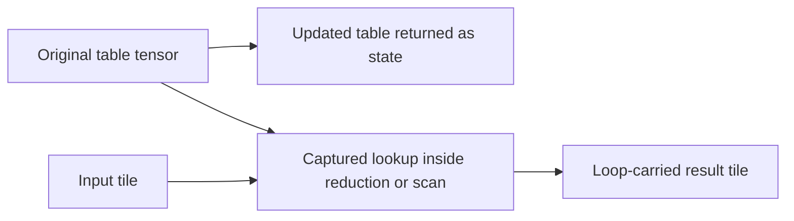

# Captured tensor lookups in reduction and scan bodies

A combiner may now read an already computed numeric tensor value, including a
table loaded before a source write. The executable MLIR keeps that immutable
snapshot as an SSA capture. It does not reload a logical pointer or use a
provenance claim to declare external memory stable.

The table and its original load stay outside the recurrence. Useful reuse,
indirect indexing, original tuple/control computation and tile shapes remain
executable. Physical residency, register packing, warps and cores stay downstream.

## Source-backed lowering

The adapter reuses Meta/shared's
[`UnsplatConverter`](https://github.com/facebookincubator/triton-shared/blob/17f0c234ce474bee334af36e351c62eca7852836/include/triton-shared/Conversion/TritonArithToLinalg/ConversionPatterns.hpp)
and the existing direct single-axis gather adaptation in
[`tile_gather.py`](../t2m/tile_gather.py). A singleton `tt.unsplat` becomes a
standard zero-coordinate `tensor.extract`; an actual singleton splat/projection
is an identity of the original scalar. Logical pointer projections stay with
the existing pointer adapter.

For a one-element gather/projection chain, the scalar index feeds the same
signed source-word bounds check used by ordinary tile gathers. One standard
`tensor.extract` reads the original captured tensor. The read and guard stay
at the original gather, including when projections are conditional or shared.
Shared projections reuse that value. Shared tensor results retain their normal
tensor gather; they are not silently replaced by a scalar result.

Every candidate validates before edits. Types, singleton/rank/axis relationships,
index widths and source fields are checked structurally. Reduction and scan
checks admit exact typed tensor reads and numeric tensor literals alongside
their existing scalar computation. The lookup pass supplies an internal set of
the exact guard operations it created. Source attributes, locations and even a
serialized clone of those operations cannot recreate that admission. Original
assertions, pointer loads and hidden helper effects keep their source audit and
separate effect requirements.

`prov.composite_family`, source shape/axis, source IDs and transformation records
retain tensor-lookup/projection intent. An original `efficient_layout` hint is
retained separately; it assigns no physical layout. Removing these attributes
leaves actual bounds, read positions and outcomes unchanged.

## Merlin values and lifetime

Merlin can offer an explicit independent initial-state copy for a checked
immutable entry tensor/view or restricted qualified import. It attaches the
copy only after the complete producer/capture proof succeeds. Typed guards stay
in their original control position; only the completed value is copied or reused.

Masked input tiles expose `tensor.pad`. A closed padding body over a checked
readable source may supply the value for that separate copy. Padding may forward
its input when no padding is needed, so it grants no ownership itself. Unknown
roots, CFG phi tensors, hidden calls/writes/reads and unrestricted imports retain
their refusals. Zero-trip values, readonly inputs and all native ownership,
bufferization and post-deallocation lifetime gates remain active. The native
destination selection passes 135 checks, including the new padding/guard cases.

## Qualification and remaining scope

Twenty-four original native-verified TTIR kernels combine i32/i64 reductions or
scans with both logical table axes and all three memory profiles. Each loads its
table snapshot, mutates the source table, then reuses the old value in a runtime
recurrence. Native execution, actual Merlin host libraries and Spike compare
both complete results as exact words: the changed table and the computed output.
The 24 target images retain all 48 results. Four further domains per library
reuse unchanged host libraries across empty inputs, zero steps, tails, modular
overflow and different associative lookup tables, for 96 runtime replays.

`out/tile-lookup-state/summary.json` reopens those target receipts. The combined
`out/tile-lookup-inventory/coverage.json` reopens 237 packages, 192 standalone
qualifications and fourteen maintained product cases, retaining all fifty
observed source names under selected native/Merlin-host profiles. The 177-check
combiner/gather/memory/corpus regression selection passes. A final 21-check
selection covers guard identity and annotation independence, one current-package
target invocation, and actual existing-library bounds aborts in both combiners.
These selections overlap and do not establish per-operation execution coverage.

These typed TTIR fixtures are not Python AST capture or GPU execution evidence.
They retain an independent reference and every public input/result. General
tensor intermediates and carried tensor state inside scalar bodies, further
numeric/capture/packing forms, direct memory/effectful combiners, source versions,
broader alias/runtime combinations and applicable accelerators remain open.
The full arbitrary-kernel goal remains active and incomplete.
