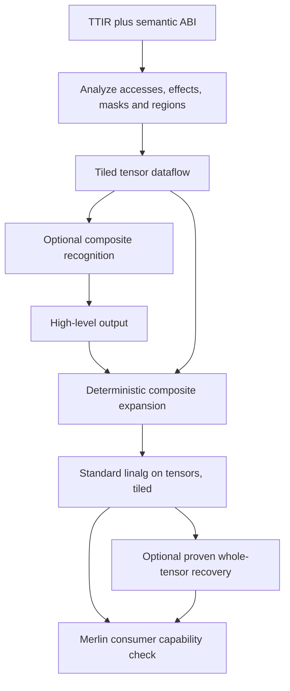

# triton2MLIR — transformation plan

**Status:** accepted architecture; exact-tile MVP and first R1 tensor-memory slice implemented. Continues the initial
survey in commit `0e6bc34`. Survey: **2026-11-06**; implementation update: **2026-11-07**.
See [ROADMAP.md](ROADMAP.md) for delivery stages, [README.md](README.md) for the runnable demo,
and [docs/package.md](docs/package.md) for explicit differences from model2MLIR's package.

**Architecture:** translate pre-layout TTIR into **tiled linalg on tensors**, preserving the
kernel's fusion, loop structure, reuse and numerical operations. Recover logical tensor accesses
from pointers before choosing hardware. Make named-composite expansion and whole-tensor recovery
separate transformations. A kernel does not need a whole-tensor representation to be portable.

## 1. Scope and decisions

The handoff records these user decisions; this revision retains them:

| Decision | Contract |
|---|---|
| D1 | Standalone repository: `grammy117/triton2MLIR`. |
| D2 | Primary consumer is Merlin, above target selection, alongside model2MLIR. |
| D3 | Selectable `high-level` and `linalg-on-tensors` outputs, with deterministic expansion between them. |
| D4 | Work through elementwise kernels, tiled GEMM, reductions/softmax, and fused attention with loop-carried state. |
| D5 | triton-cpu is a reference, never a dependency or an execution route. |

The user accepted this starting architecture on **2026-11-07**, emphasizing provenance/annotations
that preserve original data intent while operations lower to linalg. Tile-first is the design
basis: it preserves the source algorithm. Whole-first would
erase information that a later retiling pass cannot recover. Independent emitters would duplicate
the correctness problem.

Success means a downstream compiler sees recognizable tensor contractions, reductions, pointwise
regions and structured loops, without needing a Triton, CUDA, CPU-feature or device-runtime dialect.
It does not mean reproducing source-device performance on every target. Merlin still chooses
resource placement, vectorization, instruction selection and launch realization.

Initial scope: specialized shapes/strides/grid, nonaliasing buffers, ordinary loads/stores, standard
integer and floating types, structured control flow, and independent logical programs. Deferred:
cross-program atomics/communication, volatile memory, arbitrary pointer casts, inline device assembly,
RNG/dropout, general data-dependent scatter, dynamic tensor dimensions and physical async pipelines.
These receive explicit diagnostics, rather than placeholder operations advertised as portable IR.

## 2. What the source survey establishes

Local revisions are recorded in §12. Findings below distinguish existing mechanisms from proposed
extensions.

### model2MLIR: copy the decomposition discipline and output vocabulary

The `feat/triton-integration` checkout has **two different decomposition mechanisms**:

- `m2m/ir/torchmlir_decomps.py` rewrites Torch gap operators before torch-mlir legalization.
- `m2m/ir/decompositions.py:DECOMPOSITION_TABLE`, dispatched by `import_fx.py`, builds xDSL
  `linalg`/`tensor`/`arith` operations directly from FX nodes. Import verifies emitted operations
  and stamps provenance centrally. Unknown operators can become typed opaque calls.

triton2MLIR should use the second pattern for operation builders, plus analyses for facts a local
builder cannot establish. Unlike an ATen node, a TTIR load is not a complete tensor operation until
its pointer, mask, effects and surrounding iteration space have been recovered. A larger opcode
table alone cannot perform that recovery. An opaque diagnostic artifact may aid debugging, but an
unresolved call must never pass the complete-conversion gate.

`docs/OP_TAXONOMY.md` defines `high-level` as named extension operations and
`linalg-on-tensors` as their standard-dialect expansion. **Neither label means whole-tensor versus
tiled.** `scf` and `tensor.extract_slice` are already part of the portable vocabulary.
Existing composites include `linalg_ext.softmax`, layer/rms norm and activations; scan and general
gather/scatter are candidates in that document, not existing extension ops we can assume exist.

### Merlin: reuse analyses, recognize consumer limits

`src/merlin/triton/` already acquires TTIR using a stock Triton wheel, tracks affine addresses,
normalizes eligible grids, computes backward liveness and accounts for unsupported operations.
Its current bridge refuses multi-program `tt.dot`, nonzero dot accumulators and several otherwise
valid access patterns. `addressing.py:whole_tensor_access` uses bounded concrete enumeration
(`1 << 22` elements). Port the useful analysis ideas with their tests and attribution; do not
inherit whole-tensor coverage as a prerequisite for translating a tile.

**Correction to the handoff:** the IDE checkout, `merlin-graph-proof-intake` at `e47c4fd`, contains
`unaccounted_ops`, payload/result/accumulator guards, and a multiple-function refusal in
`xdsl_dialects/lowering/interface_lowering.py`. Its docstring describes the old silent-drop bug
and the guard against it. It is inaccurate to describe this revision as simply dropping unknown
payloads. The materialization limit remains: `STAGED_MATERIALIZABLE` is `{matmul, elementwise}`;
arbitrary tiled loops and attention are not thereby supported. Parsing, verified frontend output,
host execution and staged accelerator descent must be reported separately.

### triton-shared: borrow structured access recovery before the memory boundary

The pinned [`TritonStructured` definition][shared-structured] describes base, tile sizes, strides,
offsets, parent/wrap shape and order. It distinguishes tensor pointers from tensors of pointers,
and has a separate, restricted gather/scatter descriptor. Pointer, use and mask analyses provide
useful models: address-only values may disappear, while values also used by arithmetic must survive.
A descriptor describes an access; it does not prove bounds, alias freedom or parallel independence.

The complete [`TritonToLinalgExperimental` pipeline][shared-pipeline] subsequently invokes structured,
unstructured and Triton-pointer-to-memref conversions. Therefore its complete output is not our
tensor-only ingest contract. Reuse the earlier structured/tensor stages and adapt their descriptors
and computation to that contract. The implemented `shared-lower` adapter exposes these boundaries
using an existing optimizer; see [the reuse map](docs/triton_shared.md). Broad coverage should build
on upstream analyses/converters, with our semantic ABI and provenance checks added at the boundary.
That path requires version-matched project dialects and its Triton pin; no native build is implicit.

Its optional six added program-id/grid-size arguments are **not intrinsically hardware-specific**;
they express a per-program ABI. We instead want a complete-launch function with a logical grid
region, making independence and outputs visible to the consumer. A wrapper around such a per-program
ABI would also be possible after proving those facts.

The current [repository README][shared-repo] no longer contains the old unmaintained notice cited
by Merlin's historical design document. Update that rationale separately when editing Merlin;
version coupling and memory-boundary differences are the relevant objections here.

### triton-ascend: borrow the separation between logical work and physical realization

The pinned compiler has a structured-access stage and a named-op choice in its linalg conversion,
but its full pipeline also contains Ascend-specific conversions. Its output is not a drop-in
portable frontend. The [architecture guide][ascend-architecture] explains how auto-blockify folds
logical blocks into a loop over work assigned to a bounded physical launch. This supports retaining
logical program identity independently of the eventual physical-core schedule. Do not copy that
guide's simplified thread terminology into our ABI: a Triton program instance is a logical block,
not an individual hardware thread.

### triton-cpu: stop before vector/ISA selection

Its pinned [type converter][cpu-types] maps ranked tensors to vectors. The [backend pipeline][cpu-pipeline]
then selects microkernels, AMX, FMA and other feature-specific dot implementations. This is useful
reference material for masks, conversion semantics and operation coverage. It is below our intended
boundary, and is not part of acquisition, translation or validation dependencies.

## 3. Output contract: two independent choices

Proposed API:

```python
convert(ttir_or_kernel, spec,
        level="linalg-on-tensors",    # or "high-level"
        structure="preserve")         # or "canonicalize"
```

| Choice | Meaning |
|---|---|
| `level="linalg-on-tensors"` | Standard `builtin`, `func`, `arith`, `math`, `linalg`, `tensor`, `scf`, `cf`; tensor/scalar signatures; no runtime launch ABI. |
| `level="high-level"` | May additionally use explicitly supported model2MLIR composites. Every such op has a deterministic standard expansion. |
| `structure="preserve"` | Preserve the recovered tile loops, fusion and loop-carried values. Default for both levels. |
| `structure="canonicalize"` | Attempt proven whole-tensor/composite recovery on the same IR; report each accepted or declined rewrite. Remaining tiled regions are valid output. |

The default path needs no custom dialect. Quantization extensions, if later needed, must be a named
profile with explicit legalization; model2MLIR's `quant_ext` exception is not permission to claim
arbitrary custom operations are standard MLIR. Attach `prov.level` using model2MLIR's vocabulary;
record structure separately rather than inventing a third level called `kernel-tiled`.



The grid becomes an **unmapped `scf.forall`** only after proving the accepted programs independent.
Use `tensor.parallel_insert_slice` inside `scf.forall.in_parallel` for disjoint output contributions.
`tensor.insert_slice` is for sequential tensor updates, including updates within a program.
Do not attach GPU thread/block mapping attributes. Merlin may realize the resulting parallel work
sequentially, with vectors, or on hardware groups; that decision is downstream. These operations
follow the standard [SCF][mlir-scf] and [tensor][mlir-tensor] contracts.

## 4. The semantic boundary

Keep algorithmic structure as executable IR. Retain advisory schedule information as provenance.
Anything that changes observable values or ordering needs semantics, a proved elimination, or a
refusal; putting it in `prov.*` cannot legalize its removal.

| Source information | Treatment |
|---|---|
| Fusion, reduction axes, loop nesting, live state, data reuse | Explicit tensor SSA, `linalg` operations and structured regions. |
| `BLOCK_*`, logical grouping, tile traversal | Actual specialized bounds/index expressions in the initial IR; candidates for later legal schedule changes. |
| Tensor permutation, reshape, stride interpretation | Preserve logical index mapping. A physical layout choice cannot justify deleting a transpose. |
| Casts, accumulation dtype, rounding, overflow behavior, reduction order constraints | Preserve in operations and legality checks. Use explicit numeric lowering or refuse unrepresentable behavior. |
| `num_warps`, `num_stages`, cache/eviction hints, compiler-introduced bank layouts | Advisory provenance when proved irrelevant to observable behavior. |
| `multiple_of`, `max_contiguous`, `assume` | Record source assumptions. Any fact used by translation must be proved or be an explicit ABI precondition/guard. |
| Shared/local staging, async copy and waits, barriers | Recover value dependencies and memory ordering before removing storage/synchronization. Otherwise refuse. |
| Atomics, volatile access, cross-program communication | Observable effects, not hints. Refuse in the initial tensor-only subset. |
| Device math/assembly | Translate only with a defined numeric contract and implementation. No substitution based only on a similar operation name. |

For example, a Q tile loaded before an attention loop and used inside it is a reused SSA value;
the running accumulator is an `iter_arg`. This conveys reuse without choosing registers or SRAM.
Pipeline depth and shared-memory bank layout can be discarded after dependency recovery. Simply
erasing an explicit barrier does not establish that recovery: [`debug_barrier` synchronizes the
block][triton-barrier]. [`assume` grants a compiler assumption][triton-assume], not an arbitrary fact
about every caller.

### Numerical legality is part of the boundary

`tt.dot(A, B, C)` includes a real accumulator C. Map it to a contraction with **C as `outs`**;
zero-fill only when the source initializes C to zero. Preserve each load/compute/store dtype and
explicit cast, integer signedness, and applicable overflow/fast-math flags.

For f32, [`input_precision` can change the arithmetic][triton-dot]. `tf32`, `tf32x3` and related
modes must not become a plain f32 matmul plus a discardable `prov.numeric_precision` attribute.
Initial support accepts numeric configurations whose source contract is representable by the
selected standard operations. Other configurations fail with a numeric-contract diagnostic.
Later support needs a validated software expansion or a semantic operation understood and enforced
by the consumer, followed by standard legalization. A user-selected relaxed mode would be an
explicitly different contract, never the default.

This does not promise bitwise equivalence where Triton itself leaves reduction order or device math
accuracy unspecified. Record permitted variation from the pinned source contract and test against
it. Reassociation or a different reduction tree still requires permission; a numerical tolerance
in a test is not permission for a compiler rewrite.

## 5. Input boundary and semantic ABI

### Intake

Accept saved **pre-layout TTIR plus a spec** as a first-class input. Also offer a source adapter for
`@triton.jit` plus a launch specialization. TTIR is already MLIR with documented [Triton operations][triton-ops];
the job is dialect conversion and semantic recovery, not reconstructing a Python FX graph.

Use a pinned stock Triton wheel's native parser/walker behind `frontend/`. Triton's documented IR
does not imply that `ASTSource.make_ir` is a stable public API. Merlin already isolates this
internal API and supplies a nominal backend to obtain callbacks. Reuse that isolation, record the
version/options, and test for target-dependent frontend behavior. Capturing before TTGIR avoids
layout lowering, but does not make inline assembly or device library calls portable automatically.

M0 must prove nested-region/block-argument access and attribute decoding, not just a flat op walk.
If the pinned binding cannot expose what is needed, use a version-pinned structural parser/adapter;
do not recover loop semantics by regex or silently flatten regions. Keep native objects within the
adapter's lifetime. Diagnose incompatible TTIR versions at intake.

`tts` is a useful project-specific intermediate, not an upstream stable alternative boundary.
Keep a triton-shared adapter optional. Neither Ascend nor CPU lowering is required to obtain input.

### Required spec fields

| Field | Purpose |
|---|---|
| Kernel entry, TTIR dialect/version, source hash | Identify the exact input and specialization. |
| Pointer arguments: element type, logical shape, element strides, storage offset and valid storage extent | Recover logical coordinates and establish which addresses are legal. |
| Declared effects: `read`, `write`, `readwrite`; returned outputs and their ordering | Define the caller-visible ABI. Check observed accesses against declarations. |
| Aliasing/allocation identities | Initially require independent buffers. Refuse overlapping views until their shared storage is explicitly modeled. |
| Scalar arguments: type, specialized value or runtime SSA parameter | Prevent guessing values; preserve genuinely dynamic data scalars. |
| Constexprs and resolved logical grid | Define this launch, independently of physical resources. |
| Preconditions/assumptions and validation method | State where bounds, alignment or specialization facts come from. |
| Numeric profile and observable diagnostics policy | Define allowed arithmetic and treatment of assertions/printing. |

Static tensor shapes do not forbid runtime scalars. A scale can remain SSA. An unproved scalar
controlling memory bounds requires a supported guarded/predicated path or refusal; it is not a
reason to specialize every scalar by default. A caller claiming a specialized N must enforce that
specialization. Declared effects are validated by analysis, not trusted despite contradictory stores.

Tensorization changes the pointer ABI deliberately:

- A read-only buffer becomes a tensor argument.
- A completely overwritten, nonaliased output can become a tensor result initialized with
  `tensor.empty` internally, only after proving every observable element initialized.
- A readwrite buffer or preserved portion of an output needs its incoming tensor and an updated
  result. Partial stores preserve the old values; they cannot return fresh uninitialized elements.
- Multiple stores in a program require local ordering and tensor versions. Cross-program output
  contributions must satisfy the independence proof in §6.

Start with ordinary nonnegative strided views. Prove the byte/element-unit conversion, bounds and
one-to-one logical mapping; a storage layout is not implicitly contiguous. Zero-stride reads can
be broadcasts when modeled. Negative strides, aliased outputs and pointer-to-integer tricks remain
explicitly refused until implemented. Address integer wraparound cannot be erased by conversion
to MLIR `index`; prove it absent for the accepted domain or preserve it exactly.

## 6. Analysis and transformation stages

One normalized representation drives all output modes. The internal descriptors below are analysis
data, not a mandatory new output dialect.

1. **Inventory and validate regions.** Record operations, SSA values, nested blocks, terminators,
   locations, calls and memory effects. Inline supported helpers or retain verified local calls;
   unresolved external calls and unknown effect interfaces fail the complete-conversion gate.
2. **Compute backward liveness to a fixpoint.** Root it in results, stores and retained effects,
   including assertions. Do not classify a guard as dead merely because it resembles Merlin's
   overflow guards. Record why each eliminated operation is dead or semantically redundant.
3. **Classify uses.** Separate address-only, predicate, value and mixed uses. `make_range`, splats,
   broadcasts and arithmetic used by both addressing and payload must retain their payload
   meaning; address recovery is not permission to delete every index tensor.
4. **Recover accesses across control flow.** Track base identity, parent shape/strides, tile shape,
   logical index map, offsets, predicate, fill value, effects and source locations. Follow loop
   IVs and pointer `iter_args`, joins and block-pointer advances. Inconsistent branch descriptors
   require a representable conditional access or refusal.
5. **Prove mask and bounds obligations.** Classify predicates as rectangular bounds, structured
   nonrectangular masks, or unsupported. Keep predicate and load `other` distinct. Establish
   legality for all programs and loop iterations, not a single sampled tile.
6. **Prove parallel independence.** For distinct logical programs p and q, show W(p) is disjoint
   from W(q) and R(q), and W(q) from R(p), accounting for ABI aliasing. Shared read-only inputs
   may overlap. Reject inter-program atomics, polling and communication in v1. Do not serialize
   a racy kernel to invent a well-defined source meaning. Also prove each store's active
   element-to-address map injective; duplicate-address lane stores need their own defined
   conflict semantics and are refused initially.
7. **Functionalize and emit tiles.** Lift declared buffers to tensor SSA, thread updates in source
   order, map independent programs to unmapped `scf.forall`, and translate source loops with
   their actual `iter_args`. Emit contractions/reductions inside those regions.
8. **Optionally recognize composites.** Match supported semantics, axes, masks, casts and numerical
   permissions. Recognition failure leaves the explicit computation intact. Online attention is
   not replaced by a plain softmax op.
9. **Legalize the requested vocabulary.** Expand composites for standard output; verify functions,
   regions, defined results, dialect allowlist and absence of unresolved calls/pointers.
10. **Optionally recover whole-tensor computation.** Apply only the proved patterns in §8. Keep
    nonmatching regions tiled and include refusal reasons in the transformation report.

### Symbolic access domain

Begin with affine forms over program IDs, loop IVs and tile iotas with specialized coefficients.
Add bounded piecewise-affine handling of division/remainder by positive constants for flattened
grids, grouped GEMM and modulo-based tail loads. These are common source patterns; rejecting all
nonlinear-looking expressions indefinitely would exclude ordinary optimized kernels.

Modulo is a real index remapping, not a tail clamp. Loads may intentionally repeat valid elements
while stores mask padded rows. Preserve that mapping until unused elements are proved irrelevant.
General products of varying indices and loaded index tensors are outside the initial descriptor.
Later gather/scatter support needs explicit indices, bounds, duplicate/conflict rules and effects.
The existence of a strided descriptor is no proof that it covers those cases.

Use symbolic bounds/disjointness proofs for the supported patterns; avoid an IR-size or analysis
cost proportional to tensor element count. Bound analysis time and diagnostic size. If a proof is
outside the implemented domain or budget, return `not proved` and reject the affected required
translation; do not promote finite test enumeration to a general proof.

### Masks: slices are a fast path, not the definition

For offset o and block B in a one-dimensional tail, the valid upper-tail length is
`max(0, min(B, N-o))`, assuming the lower bound is also established. Extract only valid elements,
pad to the logical tile shape with the source `other`, compute, and insert only the valid result.
Lower-bound masks require the corresponding low padding/offset adjustment as well.

Parallel assembly must insert only the proved disjoint contributions. Replacing a sparse masked
store with an entire padded tile insertion can introduce overlapping writes to preserved elements,
even when the source's active writes were disjoint; such a construction needs a different
partition or must be refused.

Causal masks, diagonal predicates and data-dependent masks are not rectangular slices. Preserve
them as predicate tensors and selects **when all reads are already valid**. Otherwise use guarded
element extraction (`tensor.generate` with `scf.if` or an equivalent proved construction), or
refuse. `arith.select` around an already out-of-bounds load does not protect that load.

The [load contract][triton-load] does not make an omitted `other` an arbitrary zero. Refuse a live
undefined masked value unless its nonobservability is proved; use the specified fill exactly for
defined values. A padded reduction also needs the correct identity and source behavior: zero for
a sum is not the identity for a maximum.

## 7. Decomposition registry and operation treatment

Keep three mechanisms separate: local op builders, analysis-driven memory/control-flow recovery,
and optional subgraph recognition. Rule selection is deterministic and reports the selected rule.
No LLM-generated or unchecked decomposition is installed during conversion.

A proposed rule record contains the input opcode/version, supported types/ranks, required analysis
facts, numeric/effect preconditions, builder, defined fallback decomposition, and diagnostic reason
when inapplicable. The builder returns result mappings, emitted operations and source-op coverage.
Verification happens before committing a rewrite. Unexpected errors are conversion failures, not
permission to substitute an approximate implementation.

| TTIR family | Standard output / required treatment |
|---|---|
| Scalar `arith`/`math`, comparisons, casts | Preserve compatible scalar ops; tensor elementwise operations become `linalg.generic` scalar regions. |
| `tt.get_program_id`, `tt.get_num_programs` | Logical grid IVs and bounds, with checked integer conversion. |
| `make_range`, `splat`, `expand_dims`, `broadcast` | Consume address-only uses; materialize data uses with tensor/linalg indexing and broadcast semantics. |
| `addptr`, `make_tensor_ptr`, `advance` | Update access descriptors; no pointer operations remain in standard output. |
| Structured `tt.load` | Tensor slice or scalar extraction, with exact bounds/fill semantics. Multiple different accesses to one tensor are permitted. |
| Structured `tt.store` | Sequential tensor update within a program; disjoint parallel insertions at grid exit. |
| Masked load/store | Rectangular slice-and-pad path, otherwise explicit predication; never silently omit a mask. |
| `tt.dot` | `linalg.matmul`, `batch_matmul`, or a typed generic contraction as appropriate; accumulator is an actual operand. Check rank, signedness, precision and cast semantics. |
| `tt.reduce` | Translate the combiner region, including multiple results/tie rules, when its contract fits. Use linalg reduction/generic or explicit loops; never assume every region is add/max. |
| Scan / associative scan | Ordered `scf` construction preserving axis, direction and combine semantics initially. No dependency on a nonexistent `linalg_ext.scan`. |
| `tt.trans`, reshape, join/split, cat | Logical transpose/reshape/slice/concat with standard legalization; padding/order and source reshape permissions checked. |
| `scf.for`, `if`, supported `while` | Retain control flow, region arguments and all yielded values. Pointer state is converted to descriptor/tensor state. |
| Recognized normalization/activation | Optional existing model2MLIR composite with checked equivalence; deterministic expansion remains available. |
| Descriptor loads/stores | Later adapter only after reconstructing base, bounds, padding, rounding and effects. A descriptor is not automatically identical to a plain block pointer. |
| Gather/scatter | Defer general support. An eventual standard construction must retain indices and conflict behavior; do not invent extension ops already supported by m2m. |
| Atomics, volatile loads/stores | Refuse initially, including atomics whose returned old value is used. Later reduction recovery requires its own numeric/order/effect proof. |
| Async/staging/barrier operations | Refuse unless a dedicated analysis proves a pure tensor-dataflow replacement. Physical token operations do not leak into standard output. |
| Extern/device math and inline assembly | Allowlist a validated semantic implementation; otherwise diagnose the symbol/opcode. |
| Assertions/printing | Preserve a supported observable form (e.g. scalar `cf.assert`) or refuse under the default policy. Dropping debug observations requires an explicit policy recorded in the result. |

Metadata is stamped centrally, following model2MLIR's family taxonomy. Retain source IDs and a
conversion manifest linking each input op to emitted semantics, analysis facts or an elimination
reason. Nested-region terminators and effectful operations participate in this accounting.
Count equality alone cannot show a mask or accumulator was preserved.

The m2m/xDSL printer has known named-op discardable-attribute limitations. Test printed round trips
with pinned versions; match named operations by type. Store advisory source/proof records in a
hash-linked sidecar when needed. **Essential semantics must remain in executable operations**;
a sidecar or annotation op cannot rescue a standard export that computes different values.

## 8. Whole-tensor recovery is an optimization with additional proofs

Exact output coverage alone does not establish computational equivalence. A batched product,
transposed write and reduction across programs can all cover the expected number of elements while
meaning something different. Conversely, valid tiled GEMM necessarily rereads overlapping A/B tiles;
requiring every *input* element to be visited exactly once would reject it.

Implement a small sequence of deterministic, independently checked patterns:

1. **Elementwise grid coalescing:** a bijection between active output indices and the declared
   output domain, correct operand index maps, fills/predicates, and no dependence between programs.
2. **Tiled contraction recovery:** prove M/N tile partition, K-domain and recurrence, batch axes,
   the real initial accumulator, transpose/broadcast maps, padding and epilogue placement. Confirm
   any change to accumulation grouping is permitted by the numeric contract.
3. **Composite recognition:** use the existing normalization/activation vocabulary only where its
   expansion represents the source under the same contract. Preserve other loops as loops.

Permuted program visitation can be legal when proved bijective and independent. It need not be
refused simply because visitation is not lexicographic. Preserve the source's logical mapping in
the initial IR; changing traversal is a separate schedule decision.

No general inverse-tiling algorithm is promised. If a contraction or attention recurrence cannot
be recovered, emit the valid tiled standard form and a declined-rewrite reason. **M2 does not depend
on folding GEMM, and M4 does not depend on collapsing attention into a whole-tensor attention op.**

## 9. Concrete target shapes of the IR

These are semantic sketches, not parser-verified MLIR fixtures.

### Tiled GEMM with tails and an epilogue

```text
forall (pm, pn) in logical_grid shared_out(C):
    m = pm * BM; n = pn * BN
    acc = source_initial_accumulator(m, n)
    for k = 0 .. ceildiv(K, BK) iter_args(acc):
        a = load_tensor_tile(A, [m, k*BK], [BM, BK], source_mask_and_fill)
        b = load_tensor_tile(B, [k*BK, n], [BK, BN], source_mask_and_fill)
        acc_next = linalg.matmul(a, b, outs=acc)
        yield acc_next
    tile = source_epilogue(acc)       # including casts, bias, activation, as written
    parallel_insert_valid_tile(tile, C, [m, n])
```

The K loop carries the accumulator; the portable representation does not require a device-memory
store of the accumulator each iteration. A source nonzero accumulator remains live. The final M/N
tail crop and K-tail padding are separate obligations. Shared A/B reads across programs are expected.
No warp size or tensor-core instruction appears.

### Online-softmax attention

```text
forall (batch, head, query_tile) in logical_grid shared_out(O):
    q = load_Q_tile(...)
    (acc, m, l) = source_initial_state(...)
    for key_tile in source_key_traversal iter_args(acc, m, l):
        k, v = load_KV_tiles(...)
        s = source_scale_and_mask(linalg.matmul(q, transpose(k)))
        m_next = max(m, row_max(s))
        alpha = exp(m - m_next)
        p = exp(s - m_next)
        l_next = alpha * l + row_sum(p)
        acc_next = alpha * acc + linalg.matmul(source_cast(p), v)
        yield acc_next, m_next, l_next
    out = source_finalize(acc, l)
    parallel_insert_valid_tile(out, O, ...)
```

The formulas explain the state, not a license to rewrite source exponentials, casts or guards.
Keep source use of exp2 versus exp, approximation permissions, rescaling order, probability casts,
causal/sequence masks, and treatment of empty rows. A PyTorch SDPA reference may define an all-masked
row differently from the source kernel; do not silently impose that definition on the kernel.

This preserves the kernel's main contribution: fused QK/normalization/PV, reused Q, tile traversal,
and bounded running state. The plan must not materialize an N×N score tensor to obtain a named op.
Later hardware lowering decides where Q, K/V tiles and the running state physically reside.

## 10. Merlin and model2MLIR integration

The kernel registry remains the identity seam: model2MLIR emits a typed `func.call` and private
declaration tagged `prov.kernel`, with tensor operands in schema order and scalar launch metadata
in `prov.kernel_args`. See its `docs/guides/triton_kernel_integration.md`.

Provide an optional binder that maps that schema to a concrete kernel/spec specialization,
translates it, checks exact tensor types/results/effects and replaces the declaration with a real
body. Output pointer parameters in TTIR are not automatically call operands: the binder must map
them to functional results. Missing defaults, specialization/stride mismatches, unsupported mutation
and aliasing refuse binding. The existing registry does not support `mutates_args`; do not claim
that standalone readwrite tensorization makes model integration support mutation.

Current Merlin's staged materializer requires one function per module and does not generally
materialize SCF tile loops. Consequently, filling a declaration is an integration seam, **not an
end-to-end feature already requiring no consumer work**. Plan explicit outlining/inlining or a
generic multi-function path, then assess supported tensor/SCF payloads before staged descent.
Use equivalent hand-authored tensor MLIR to expose generic consumer gaps; solve those in Merlin
instead of adding backend-specific exceptions to this frontend.

`docs/design/macro_scheduling.md` in the IDE checkout operates on formed dispatch groups, buffer
lifetimes, configuration state and launch/await tokens. triton2MLIR supplies the algorithmic kernel
body **before** those choices. Tensor dependencies and fusion boundaries can inform grouping;
frontend TTIR async-copy tokens must not become Merlin host/device launch tokens.

Treat source tile sizes as an initial schedule, not guaranteed physical tiles or mandatory accelerator
configurations. Merlin can legally retile while preserving dependencies/numerics, and can preserve
a fused region while choosing different storage. Algorithmic fusion should survive until a
downstream transformation deliberately changes it.

## 11. Implementation milestones and acceptance evidence

| Milestone | Deliverable | Required evidence |
|---|---|---|
| M0: intake and contract | Spec/result/report types; saved-TTIR parser and source adapter; nested-region/attribute probe; unmasked vector add; complete op accounting. | Reproducible capture, valid standard output, execution against a reference, located refusal for an unknown live op. No GPU or native compiler build required. |
| M1: tensor memory recovery | Mixed-use analysis, strided/transposed reads, bounds/masks/padding, partial-update semantics where an initial tensor is supplied. | n=1000/B=256 tail; unmasked n=1000 refused and n=1024 accepted; nonzero `other`; invalid address never evaluated; alias/effect/conflicting-write refusals. |
| M2: tiled GEMM | Parallel output tiles, K-loop/pointer recurrence, real accumulator, types/casts and epilogues; constant div/rem patterns incrementally. | Multiple programs, nonzero init, ragged M/N/K, transposed weights and batch indexing; numeric comparison; output remains tiled and source fusion retained. Folding is optional. |
| M3: reductions and softmax | Combiner-region translation, multi-result reductions where supported, ordered scans, fused masked softmax. | Axes/tie/dtype/NaN behavior; non-power-of-two valid extents; explicit all-masked behavior; named-composite expansion agreement when enabled. |
| M4: fused attention | QK and PV contractions with loop-carried `(acc,m,l)`, causal and sequence tails, explicit source casts/rescaling. | Multiple query tiles and key iterations; comparison to source interpreter and independent dense reference within the declared numeric contract; no N×N score allocation or loop unrolling proportional to sequence length. |
| M5: convergence and binding | Selected whole-tensor recovery patterns, optional m2m composite adapter/binder, consumer capability report and agreed Merlin changes. | Tiled versus transformed execution; `mlp_basic` / `mlp_basic_triton` pair; same weights/math/results; retained effects and expected source-to-consumer operation coverage. Report host versus staged support separately. |

M0's parser/region probe and M2's recurrence preservation are the main feasibility gates. Do not
wait until attention to discover that the input adapter cannot expose loop state. More general
descriptor operations, async recovery, scatter or atomics are later capabilities, not hidden
prerequisites for M4's ordinary pointer-load attention example.

### Validation strategy

1. **Structural and effect checks:** verify in memory and after text round trip, enforce the
   dialect/signature allowlist, and check every source operation's semantic disposition. Exercise
   negative cases, stale/missing metadata, aliasing, partial writes and unsupported numeric modes.
2. **Independent numerical reference:** execute emitted standard MLIR with a pinned host runner
   after ordinary bufferization/lowering, or a demonstrably complete Merlin host route. Compare
   to `TRITON_INTERPRET=1` where supported and to a separate NumPy/PyTorch reference. Interpreter
   support for descriptors/device intrinsics is not assumed; label unsupported oracle cases.
3. **Transformation agreement:** compare the same tiled module before/after composite expansion
   and optional coalescing. There is no second direct whole-tensor emitter. Use exact comparisons
   for integer/defined exact behavior and contract-specific checks for floating results, NaNs,
   infinities and signed zeros.
4. **Frontend convergence:** compare against model2MLIR using the existing MLP pair and additional
   hand-authored linalg equivalents. Compare normalized semantics, ABI/effects and execution;
   byte-identical IR is useful for specific canonical cases, not a general correctness requirement.
5. **Retention checks:** assert that attention keeps bounded tile state, GEMM keeps K-loop
   recurrence, and emitted/analysis size does not scale with enumerated element count. An
   accelerator compilation PASS alone proves neither numerical correctness nor work retention.

The reference projects can provide differential examples, but no large Triton/LLVM build is needed
for documentation work or a default developer install. On this shared VM, native builds or long
benchmarks require prior approval; check CPU/load, cap workers and keep scratch under the allowed
project roots when such work is authorized.

## 12. Package shape, reference map and next work

Proposed implementation: Python analysis and xDSL builders, matching the existing tooling.
This is the implemented small stock-wheel/reference path. For broader coverage, prioritize the
upstream stage adapter and functional tensor/provenance bridge described in the roadmap rather
than independently recreating all of triton-shared's supported operations and region analyses.
The standard-only core does not import model2MLIR/PyTorch. An optional pinned integration extra
reuses m2m's existing composite definitions/expansion and registry contract rather than vendoring
copies. Coordinate incompatible xDSL versions explicitly. If shared dialect code is later split
into a small common package, both projects can depend on it; that is not an M0 prerequisite.

`ConversionResult` should contain the requested MLIR, resolved tensor/scalar ABI, input/spec hashes,
tool versions/options, numeric profile, source-op disposition manifest, proof/refusal report and
performed/declined transformations. Keep frontend conversion status separate from downstream
capability and execution status. Save TTIR, the resolved spec and output as reproducible artifacts;
preserve source locations for diagnostics without making semantic hashes depend on absolute paths.

```text
t2m/
  api.py, cli.py, spec.py, result.py
  frontend/                  # all Triton internals, parser/version adapter
  analysis/
    liveness.py, uses.py, accesses.py, masks.py, effects.py, independence.py
  ir/
    rules.py, emit.py, provenance.py   # one semantic emission path
  transforms/
    recognize.py, expand.py, coalesce.py
  integrations/
    model2mlir.py, merlin.py   # optional; ABI binding and capability checks
  coverage.py, diagnostics.py
kernels/                     # source + TTIR + spec + references + expected evidence
tests/                       # analysis, conversion, negative cases, execution
docs/                        # contract, supported subset, milestone evidence
```

Reference checkouts on a26:

| Reference | Local path and surveyed revision |
|---|---|
| Initial plan | `/scratch/grammy/triton2MLIR-plan/triton2MLIR`, `0e6bc34ffdb526edf93d92fc99b6ac637769ffd7` |
| Merlin bridge used in original survey | `/scratch/grammy/blast/merlin`, original survey `e45205bf9`; this revision does not assume every worktree is identical. |
| Merlin IDE checkout used for this revision | `/scratch/grammy/blast/merlin-graph-proof-intake`, `e47c4fd16999d44371e70f931288afba26da48d6`; `src/merlin/triton/`, `src/merlin/xdsl_dialects/lowering/interface_lowering.py`, `docs/design/macro_scheduling.md`. |
| model2MLIR | `/scratch/grammy/blast/model2MLIR`, `feat/triton-integration`, `035bb5a371cb463a0ac75186beb754c5f7200395`. |
| triton-shared | `/scratch/grammy/refs-triton2mlir/triton-shared`, `17f0c234ce474bee334af36e351c62eca7852836`; its `triton-hash.txt` pins `142586f90aac9b917af1081e4697b085027e13b2`. |
| triton-ascend | `/scratch/grammy/refs-triton2mlir/triton-ascend`, `8f0ade66580245e30ad97093526a4018e4e18fc7`; `third_party/ascend/backend/compiler.py`, structured dialect/conversions and migration guide. |
| triton-cpu | `/scratch/grammy/refs-triton2mlir/triton-cpu`, `ef84a29ac523dcef1dadaf5677ffc881f1009fce`; CPU type converter, backend pipeline, `OptimizeMasks` / `ConvertUnsupportedOps`. |

The initial standard-only slice now implements spec/result/trace data, source/saved-TTIR intake,
exact-tile symbolic checks, tiled vector add and multiply-add, and model2MLIR-shaped bundles.
Nested source regions are explicitly refused, so the original M0 is only partially implemented.
R1 now includes rectangular masks/padding, pointwise undefined-lane tracking, positive-stride views,
partial readwrite results, read reuse, and strict native verification/LLVM legalization. Native code
execution, region/attribute intake and the remaining R1 access/control features are still open,
before multi-program GEMM. The detailed roadmap supersedes this
document's original milestone ordering for delivery tracking.
The remaining research items are the supported symbolic proof subset, numeric modes beyond the
initial compatible subset, and Merlin's generic tiled-loop consumption. None requires choosing
GPU hardware in the frontend.

[shared-repo]: https://github.com/facebookincubator/triton-shared
[shared-structured]: https://github.com/facebookincubator/triton-shared/blob/17f0c234ce474bee334af36e351c62eca7852836/include/triton-shared/Dialect/TritonStructured/IR/TritonStructuredDialect.td
[shared-pipeline]: https://github.com/facebookincubator/triton-shared/blob/17f0c234ce474bee334af36e351c62eca7852836/lib/Conversion/TritonToLinalgExperimental/TritonToLinalgExperimentalPass.cpp
[ascend-architecture]: https://github.com/triton-lang/triton-ascend/blob/8f0ade66580245e30ad97093526a4018e4e18fc7/docs/en/migration_guide/architecture_difference.md
[cpu-types]: https://github.com/triton-lang/triton-cpu/blob/ef84a29ac523dcef1dadaf5677ffc881f1009fce/third_party/cpu/lib/TritonToTritonCPU/TypeConverter.cpp
[cpu-pipeline]: https://github.com/triton-lang/triton-cpu/blob/ef84a29ac523dcef1dadaf5677ffc881f1009fce/third_party/cpu/backend/compiler.py
[triton-ops]: https://triton-lang.org/main/dialects/TritonOps.html
[triton-dot]: https://triton-lang.org/main/python-api/generated/triton.language.dot.html
[triton-load]: https://triton-lang.org/main/python-api/generated/triton.language.load.html
[triton-barrier]: https://triton-lang.org/main/python-api/generated/triton.language.debug_barrier.html
[triton-assume]: https://triton-lang.org/main/python-api/generated/triton.language.assume.html
[mlir-scf]: https://mlir.llvm.org/docs/Dialects/SCFDialect/
[mlir-tensor]: https://mlir.llvm.org/docs/Dialects/TensorOps/
